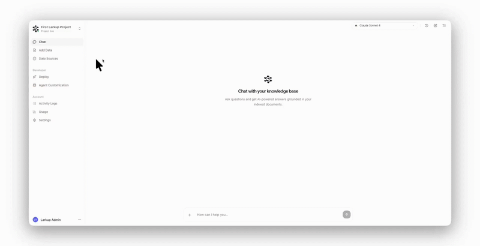
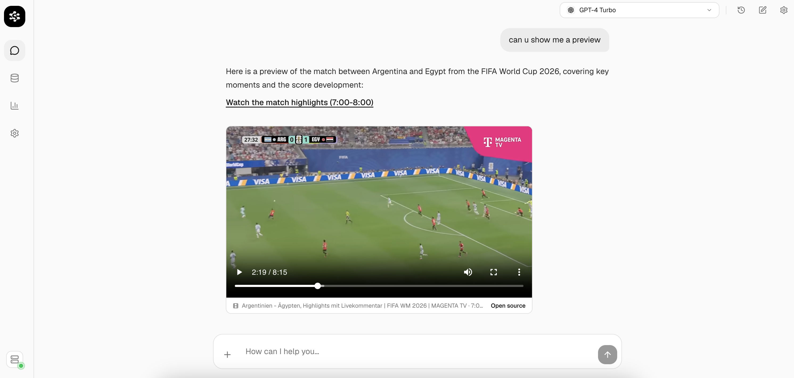
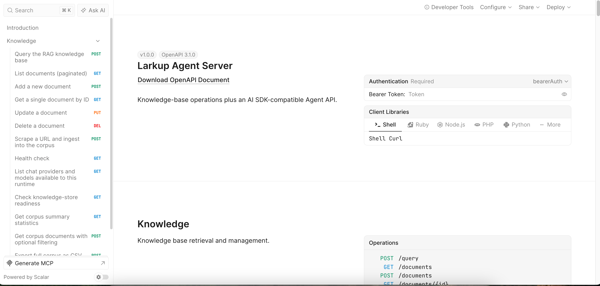

<div align="center">
  

  <br />

**A local NotebookLM with deeper file analysis, plus a headless RAG server for your AI apps.**

[Documentation](https://www.larkup.de/docs) · [GitHub Issues](https://github.com/Larkup-AI/larkup/issues)

</div>

---

> [!WARNING]
> **Larkup is under active development.** Interfaces, stored data formats, and
> package APIs can change between releases. Pin an exact version if you build on
> it, check the [release notes](https://github.com/Larkup-AI/larkup/releases)
> before upgrading, and please [open issues](https://github.com/Larkup-AI/larkup/issues).



## What is Larkup?

Larkup is a local, open source NotebookLM that goes deeper into your files:

- **Search hundreds of files at once.** One question searches across every source in a project.
- **Analyze tabular data.** CSVs and spreadsheets keep their structure, so answers can be computed and returned as charts.
- **Headless mode.** Launch a RAG server over your data in minutes and connect your own AI agents and apps to it through the TypeScript or Python SDK.

## Installation

### Install script (recommended)

macOS / Linux:

```bash
curl -fsSL https://www.larkup.de/install.sh | bash
larkup dev
```

Windows (PowerShell):

```powershell
powershell.exe -NoProfile -ExecutionPolicy Bypass -Command "[Net.ServicePointManager]::SecurityProtocol = [Net.SecurityProtocolType]::Tls12; & ([ScriptBlock]::Create((Invoke-RestMethod 'https://raw.githubusercontent.com/Larkup-AI/larkup/main/scripts/install.ps1').TrimStart([char]0xFEFF))) -NoPrompt"
larkup dev
```

The script installs Node.js if needed and adds `larkup` to your PATH.

### Docker

```bash
docker run -d -p 4567:4567 -p 8080-8090:8080-8090 -v larkup_data:/app/apps/web/.larkup \
  -e OPENAI_API_KEY=your_key \
  aboneda/larkup:latest
```

Or with Docker Compose:

```bash
git clone https://github.com/Larkup-AI/larkup.git
cd larkup
docker compose -f docker/docker-compose-prod.yaml up -d
```

Port `4567` serves the web app; ports `8080` to `8090` serve the RAG servers you launch. See [docker/README.md](./docker/README.md) for details.

### From source

```bash
git clone https://github.com/Larkup-AI/larkup.git
cd larkup
pnpm install
pnpm dev
```

Open [http://localhost:4567](http://localhost:4567), add an API key, add your data, and start chatting.

## What you can index

- **Documents:** PDF, Word, Markdown, plain text
- **Tabular data:** CSV and spreadsheets
- **Websites:** single pages or full crawls
- **Media:** audio and video

See [Data loading](https://www.larkup.de/docs/guide/data-loading) and [Data analysis](https://www.larkup.de/docs/guide/data-analysis).

## Video intelligence (experimental)

Videos are indexed into timestamped evidence, so answers cite the exact moment they came from.



See the [Video chat guide](https://www.larkup.de/docs/guide/video-chat).

## RAG server

Any project can run as a RAG API with its own OpenAPI reference.



Start it from **Settings → Server**. It listens on `http://localhost:8080`, with the reference at `/reference`. See [Build a RAG server](https://www.larkup.de/docs/guide/build-rag-server) and [Deploy](https://www.larkup.de/docs/developer/deploy).

## SDKs

### TypeScript

```bash
npm install @larkup/sdk
```

```typescript
import { LarkupClient } from '@larkup/sdk';

const client = new LarkupClient({
  baseUrl: 'http://localhost:8080',
  apiKey: process.env.LARKUP_API_KEY,
});

const results = await client.query('What is the refund policy?', 5);

for await (const event of client.chat('Summarize the answer.')) {
  if (event.type === 'text-delta') process.stdout.write(event.text ?? '');
}
```

### Python

```bash
pip install larkup
```

```python
from larkup import LarkupClient, LarkupClientOptions

client = LarkupClient(
    LarkupClientOptions(
        base_url="http://localhost:8080",
        api_key="your-api-key",
    )
)

results = client.query("What is the refund policy?", top_k=5)

for event in client.chat("Summarize the answer."):
    if event.type == "text-delta":
        print(event.text or "", end="", flush=True)
```

See the [TypeScript SDK](https://www.larkup.de/docs/sdk/typescript), [Python SDK](https://www.larkup.de/docs/sdk/python), and [API reference](https://www.larkup.de/docs/api-reference/overview).

## CLI

The install script includes the CLI. You can also install it with npm:

```bash
npm install -g larkup
```

Use `larkup dev` to start the web app, and `larkup query`, `larkup chat`, `larkup documents`, or `larkup media` from the terminal. See the [CLI reference](https://www.larkup.de/docs/developer/cli).

## Contributing

Read [CONTRIBUTING.md](./CONTRIBUTING.md) for local setup, tests, and the changeset workflow, then open an [issue](https://github.com/Larkup-AI/larkup/issues) or a pull request.

## License

Larkup uses an **Open Core** licensing model.

- **Community Edition:** everything in this repository is open source under the [Apache License 2.0](./LICENSE).
- **Enterprise Edition:** advanced features are proprietary, not distributed in this repository, and require a commercial license. Contact [Larkup](https://www.larkup.de) for terms.

Copyright (c) 2025 to 2026 Larkup UG
